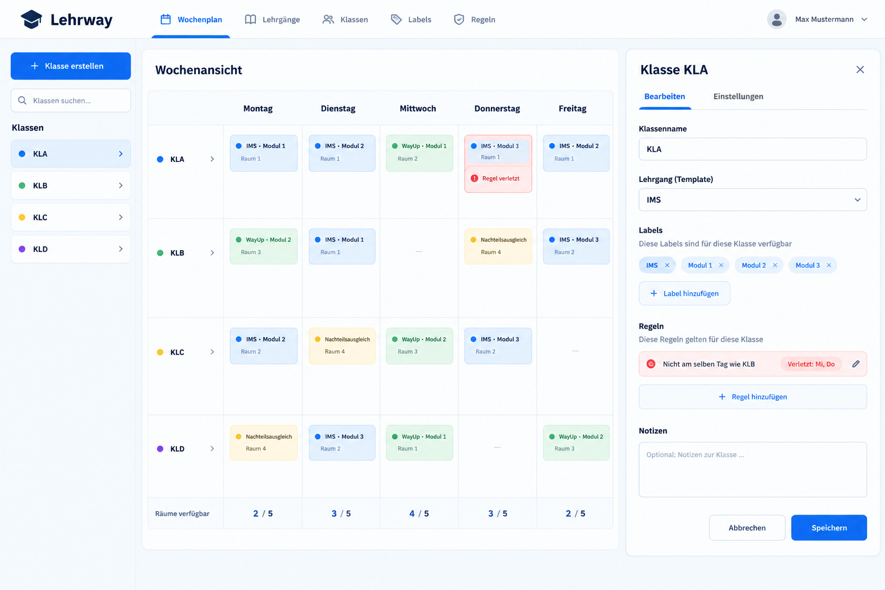

# Lehrway – Frontend

**Lehrway** ist eine Webanwendung zur übersichtlichen Planung von Klassen, Schultagen und Lehrgängen. Dieses Repository enthält das **Frontend**: die Benutzeroberfläche, über die Lehrgänge aufgebaut, Module über Quartale verteilt und Klassen in einer Wochenübersicht organisiert werden können.

> **Projektstatus:** Frontend in Entwicklung. Einige Funktionen sind bereits interaktiv umgesetzt, andere sind im Mockup vorgesehen. Eine dauerhafte Speicherung der Planungsdaten und die vollständige Benutzerverwaltung erfordern ein separates Backend.

## Projektteam

- Luka
- Noel
- Khalil
- Kenan

## Ziel des Projekts

Lehrway soll die Planung von Lehrgängen und Klassen vereinfachen. Statt Informationen an verschiedenen Orten zu verwalten, sollen Lehrgänge, Module, Lektionen, Schultage und Raumkapazitäten in einer gemeinsamen, verständlichen Oberfläche dargestellt werden. Dabei helfen automatische Hinweise, mögliche Planungskonflikte frühzeitig zu erkennen.


## Seiten und Funktionen

### 1. Login

Die Loginseite ist der vorgesehene Einstieg in die Anwendung. Benutzer geben ihre E-Mail-Adresse und ihr Passwort ein. Beim Absenden wird eine `POST`-Anfrage an `http://localhost:3000/api/login` gesendet. Wenn die Antwort erfolgreich ist und `success` zurückliefert, erfolgt die Weiterleitung nach `/home`. Bei Fehlern erscheint eine Meldung.

**Wichtig:** Die eigentliche Prüfung der Zugangsdaten findet nicht im Frontend statt. Ohne laufendes Backend ist der Login nicht vollständig nutzbar. Sobald die Datenbank bereit ist, wird diese Nachricht gelöscht.

### 2. Registrierung

Die Registrierungsseite bietet Felder für E-Mail, Passwort und Passwortbestätigung. Aktuell prüft das Frontend, ob die beiden Passwörter übereinstimmen, und leitet danach zur Homepage weiter.

**Aktueller Stand:** Es wird noch kein Benutzerkonto auf einem Server erstellt. Die Registrierung ist bisher eine Frontend-Demonstration. Die Ausgabe von Passwörtern in der Browserkonsole sollte vor einem produktiven Einsatz entfernt werden. Sobald die Datenbank bereit ist, wird diese Nachricht gelöscht.

### 3. Homepage – Wochenübersicht

Die Homepage zeigt eine Wochenplanung von **Montag bis Freitag**. Klassen werden zeilenweise dargestellt; pro Tag kann festgelegt werden, ob die Klasse Unterricht hat.

Im bereitgestellten Frontend-Code enthalten sind:

- Klassen erstellen, auswählen, suchen, umbenennen und löschen
- Gleichnamige Klassen innerhalb eines Schuljahres verhindern
- Schultage einer Klasse durch Anklicken ein- und ausschalten
- Zwischen Schuljahren wechseln; beim erstmaligen Wechsel in ein neues Jahr werden die bisherigen Planungsdaten als Ausgangspunkt kopiert
- Regeln festlegen, nach denen zwei Klassen **nicht am gleichen Tag** Unterricht haben dürfen
- Regelverstösse in der Wochenübersicht kennzeichnen
- Raumkapazitäten für einzelne Wochentage erhöhen oder verringern
- Warnen, wenn mehr Klassen eingeplant sind als Räume verfügbar sind


### 4. Lehrgänge – Lehrplanverwaltung

Auf der Lehrgangsseite können Lehrgänge erstellt, gesucht, ausgewählt, umbenannt und gelöscht werden. Jeder Lehrgang enthält eigene Module, die hinzugefügt oder entfernt werden können.

Der Lehrplan ist in **drei Lehrjahre, sechs Semester und zwölf Quartale** aufgeteilt. Innerhalb eines Moduls können Felder über ein oder mehrere aufeinanderfolgende Quartale angelegt werden. Dazu wird zuerst ein Startquartal und danach ein Endquartal im selben Modul gewählt. Für jedes Feld kann eine **Anzahl Lektionen** eingetragen und später bearbeitet werden.

Die Anwendung prüft dabei, ob der gewählte Quartalsbereich bereits durch ein anderes Feld belegt ist, und verhindert solche Überschneidungen.

Beispielsweise lässt sich ein Modul wie `M117` in einem Lehrgang `IMS` eintragen, über mehrere Quartale planen und mit einer Lektionenzahl versehen.

## Mockup und Design

Das folgende Mockup zeigt die angestrebte Gestaltung der Wochenübersicht:



Die Darstellung sieht eine Navigationsleiste, eine Klassenliste, eine zentrale Wochenübersicht und ein Bearbeitungsfeld für die ausgewählte Klasse vor. Farbliche Markierungen sollen Lehrgänge, Module und mögliche Regelverstösse schnell erkennbar machen.

**Hinweis:** Das Mockup ist eine Designvorlage und entspricht nicht in allen Details dem derzeitigen Funktionsumfang. Deswegen wird das Endprodukt nicht aussehen wie das Mockup, aber das Mockup steht für die Inspiration da.

## Navigation und typischer Ablauf

1. Benutzer öffnen die Login- oder Registrierungsseite.
2. Nach dem Login bzw. dem derzeitigen Registrierungsablauf gelangen sie zur Homepage.
3. In der Wochenübersicht verwalten sie Klassen, Schultage, Regeln und Raumkapazitäten.
4. Über **Lehrgänge** öffnen sie die Lehrgangsverwaltung.
5. Dort erstellen sie Lehrgänge und Module und verteilen Lektionen auf Quartale.


## Frontend lokal starten

Vorausgesetzt werden **Node.js** und ein passender Paketmanager (z. B. npm). Im Frontend-Projektordner können die Abhängigkeiten installiert werden:

```bash
npm install
```

Falls das Projekt wie üblich mit einem `dev`-Script eingerichtet ist, lässt sich der Entwicklungsserver starten mit:

```bash
npm run dev
```


## Datenhaltung und Backend-Abgrenzung

Der aktuelle Code verwaltet Klassen, Schuljahre, Regeln, Raumkapazitäten, Lehrgänge, Module und Quartalsfelder mit reaktivem Vue-State (`ref` und `computed`). Die Beispieldaten sind direkt in den Komponenten definiert. **Änderungen werden noch nicht dauerhaft in einer Datenbank gespeichert** und können beim Neuladen verloren gehen.

Dieser Abschnitt wird nach der Finalisierung der Datenbank gelöscht.

## Nächste Schritte

- Login und Registrierung vollständig mit dem Backend verbinden
- Sichere Sitzungsverwaltung und Schutz der geschützten Routen ergänzen
- Klassen, Lehrgänge, Module und Planungen dauerhaft speichern und laden mit Datenbank
- Frontend-Design weiter an das Mockup anpassen
- Formulare, Fehlermeldungen und Bedienbarkeit weiter verbessern
- Funktionen und Konfliktprüfungen testen

## Zusammenfassung

Lehrway bietet bereits eine interaktive Grundlage für die Klassen- und Lehrgangsplanung. Die Wochenübersicht unterstützt Klassenverwaltung, Schultage, Regeln und Raumkapazitäten. In der Lehrgangsverwaltung lassen sich Lehrgänge und Module organisieren sowie Lektionen über Quartale planen.
