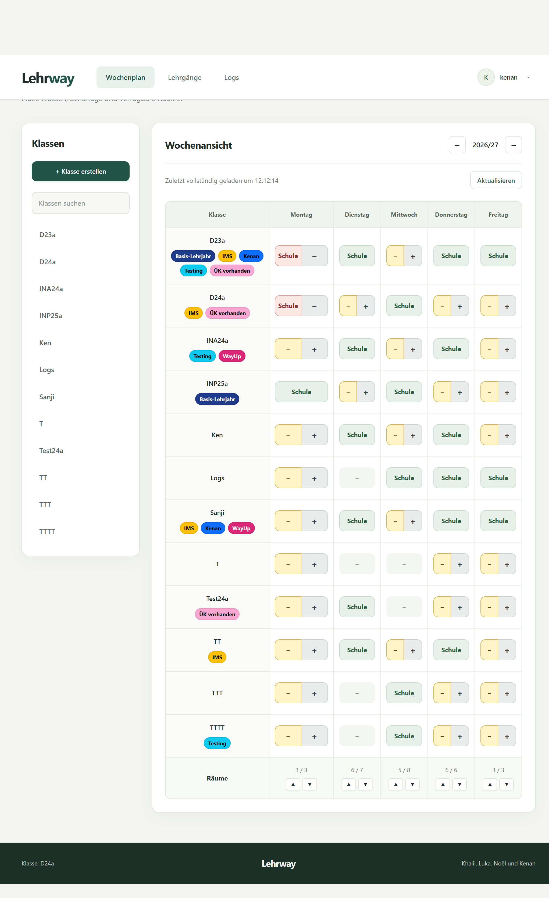
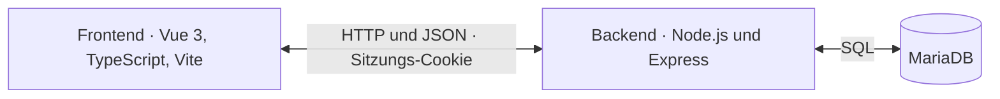

# Lehrway – Klassen und Lehrgänge gemeinsam planen

**IPT 8.1** · Vue 3 · TypeScript · Vite · Express · MariaDB

Lehrway ist eine Webanwendung für die gemeinsame Schulplanung. In der Wochenansicht sieht das Team, welche Klassen an welchen Tagen Unterricht haben, wie viele Räume dafür benötigt werden und wo Konflikte entstehen. Auf der Lehrgangsseite lassen sich Module und Lektionen über mehrere Quartale planen.



[Alle fünf Seiten ansehen](docs/frontend-seiten.md) · [Ursprüngliches Mockup ansehen](docs/mockups/Mockup_Lehrway.png)

## Nutzen und Ziele

- **Schultage und Räume gemeinsam planen.** Die Wochenansicht zeigt Unterrichtstage und Raumkapazitäten in derselben Tabelle. So lässt sich erkennen, ob für die geplanten Klassen genügend Räume vorhanden sind.
- **Konflikte vor dem Eintragen erkennen.** Lehrway zeigt an, wenn zwei Klassen laut Regel am selben Tag keinen Unterricht haben dürfen oder wenn Räume fehlen. Das Planungsteam entscheidet, ob es die Änderung trotzdem übernimmt.
- **Lehrpläne über mehrere Semester pflegen.** Die Quartalsansicht zeigt, wann ein Modul stattfindet und wie viele Lektionen dafür vorgesehen sind.
- **Änderungen im Team nachvollziehen.** Der Änderungsverlauf zeigt, wer die Planung angepasst hat, und bietet für protokollierte Änderungen einen Vorher-Nachher-Vergleich.

## Funktionen

| Bereich | Was du damit machen kannst |
| --- | --- |
| **Wochenplan** | Schuljahr wählen, Klassen suchen und verwalten, Schultage festlegen und Raumkapazitäten anpassen |
| **Regeln und Labels** | Konfliktregeln zwischen Klassen festlegen und Klassen mit wiederverwendbaren farbigen Labels kennzeichnen |
| **Lehrgänge** | Lehrgänge mit zwei, vier, sechs oder acht Semestern verwalten und Module mit Lektionenzahlen über Quartale planen |
| **Änderungsverlauf** | Nach Text, Benutzer, Änderungsart und Zeitraum filtern und ältere Einträge nachladen |
| **Benutzerkonto** | Mit Anzeigename registrieren, mit E-Mail und Passwort anmelden und die Sitzung über das Benutzermenü beenden |

## Architektur



Dieses Repository enthält das Frontend. Die API und die Datenbankkonfiguration befinden sich im [Lehrway-Backend](https://github.com/NoelWenger/LehrWay_Backend).

## Lokal starten

**Voraussetzungen:** Node.js gemäss `engines` in [`package.json`](package.json), npm und ein laufendes Lehrway-Backend mit MariaDB. Das Frontend verlangt Node.js ab 22.18 innerhalb der 22er-Reihe oder ab 24.12.

Im Frontend-Ordner ausführen:

```bash
npm ci
npm run dev
```

Öffne anschliessend die Adresse, die Vite im Terminal anzeigt. Standardmässig verwendet das Frontend `http://localhost:3000/api`. Wenn das Backend unter einer anderen Adresse erreichbar ist, setze `VITE_API_URL` in der Datei `.env.local` im Frontend-Hauptordner:

```dotenv
VITE_API_URL=http://localhost:3000/api
```

Bei getrennten Adressen für Frontend und Backend muss die Frontend-Adresse in `FRONTEND_ORIGINS` im Backend eingetragen sein, damit der Browser das Sitzungs-Cookie bei API-Anfragen verwenden kann.

```bash
npm run type-check
npm run build
```

`type-check` prüft TypeScript und Vue-Komponenten. `build` erstellt den auslieferbaren Frontend-Build in `dist/`.

## Dokumentation

| Dokument | Inhalt |
| --- | --- |
| [Technologieentscheid](docs/Technologienentscheid.md) | Technologien, ihre Aufgaben und die Aufteilung zwischen Frontend und Backend |
| [Modulübersicht](docs/moduleuebersicht.md) | Seiten, Komponenten und Dienste mit Links zum Code |
| [Funktionsübersicht](docs/funktionsuebersicht.md) | Bedienabläufe, Konfliktprüfung und Codebeispiel |
| [Frontend-Seiten](docs/frontend-seiten.md) | Routen und Bilder aller fünf Seiten |
| [Design](docs/design.md) | Farbpalette, Bedienmuster und ursprüngliches Mockup |
| [Protokolle](docs/Protokolle/) | Projektbesprechungen und Arbeitsstand |

## Projektteam

Lehrway entstand im Rahmen der Projektarbeit **IPT 8.1**. Zum Team gehören **Luka, Noël, Khalil und Kenan**.