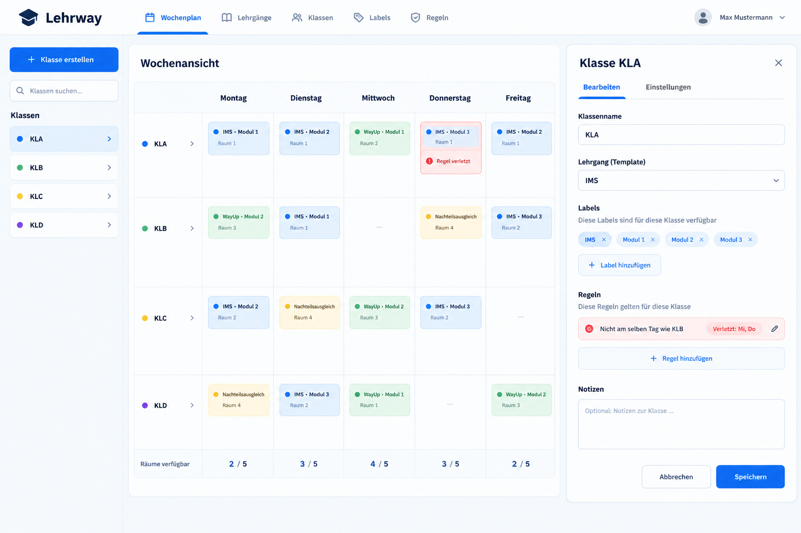

# Design

Lehrway verwendet eine ruhige Grundpalette, damit die Zustände im Wochenplan schnell erkennbar sind. Die Oberfläche zeigt die Klasse und den Wochentag im jeweiligen Kontext. Konfliktdialoge erklären, welche Klassen oder Räume betroffen sind.

## Farbpalette

| Rolle | Farbe | Einsatz |
| --- | --- | --- |
| Primärfarbe | `#205447` | Wichtige Aktionen und Hervorhebungen |
| Seitenhintergrund | `#f3f4f1` | Hintergrund hinter Tabellen und Formularen |
| Oberfläche | `#ffffff` | Karten, Eingabefelder und Dialoge |
| Text | `#202c29` | Überschriften und Standardtext |
| Warnung | `#fff4c7` | Möglicher Konflikt beim Eintragen eines Schultags |
| Konflikt | `#fbe8e5` | Belegter Schultag mit bestehendem Konflikt |
| Direkte Aktion | `#e9ecea` | Plus- oder Minus-Hälfte eines Schultagfelds mit Konflikt |

Die Grundfarben und gemeinsamen Regeln stehen in [`main.css`](../src/assets/main.css). Die Farben für Schultagfelder mit Konflikten werden in [`WeeklySchedule.vue`](../src/components/WeeklySchedule.vue) gesetzt.

## Bedienmuster

- **Navigation.** Wochenplan, Lehrgänge und Logs sind nach dem Login über die Hauptnavigation erreichbar.
- **Tabellen.** Die Wochenansicht richtet Klassen an den Wochentagen aus. Der Lehrplan richtet Module an den Quartalen aus.
- **Lange Auswahllisten.** Auswahlfelder für Klassen, Labels, Lehrgänge und Logbenutzer bieten eine Suche und eine scrollbar begrenzte Ergebnisliste.
- **Rückmeldungen.** Formularfehler erscheinen im Formular. Bei Konflikten zeigt der Bestätigungsdialog die Gründe vor der Aktion an.
- **Schultagfelder mit zwei Aktionen.** Die farbige Hälfte öffnet die Konfliktdetails. Die hellgraue Hälfte führt die mit `+` oder `−` bezeichnete Aktion direkt aus.

## Ursprünglicher Entwurf

Das Mockup zeigt die frühe Idee einer Wochenansicht mit Klassenauswahl und Bearbeitungsbereich.

In der umgesetzten Oberfläche öffnet sich die Klassenbearbeitung als Seitenleiste. Konfliktdialoge, Labels und der Änderungsverlauf ergänzen den ursprünglichen Entwurf. Die fertigen Ansichten sind in der [Übersicht der Frontend-Seiten](frontend-seiten.md) zu sehen.