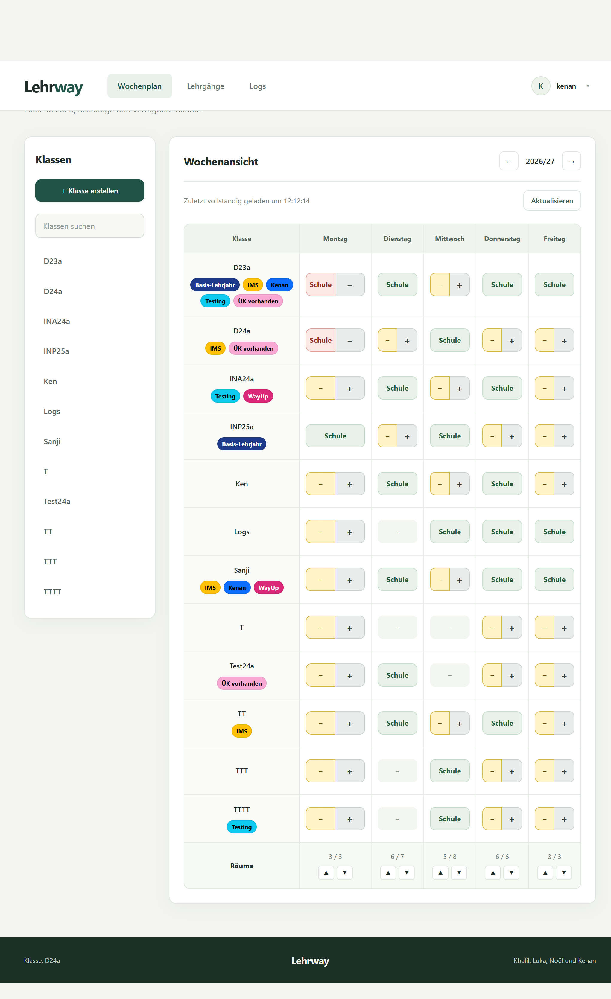
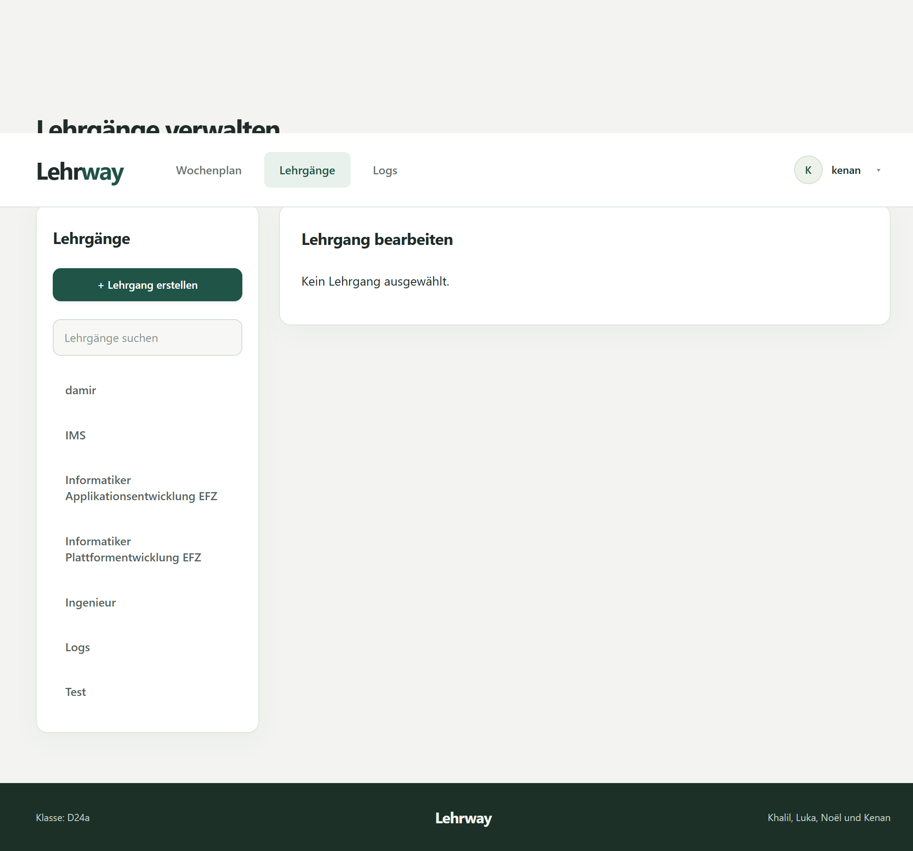
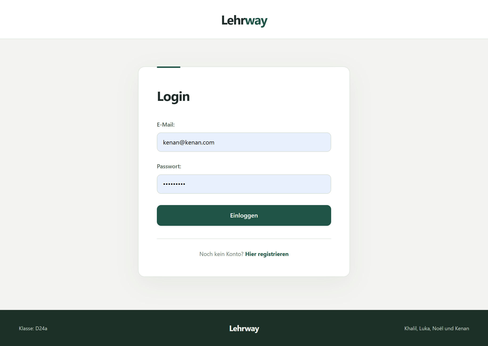
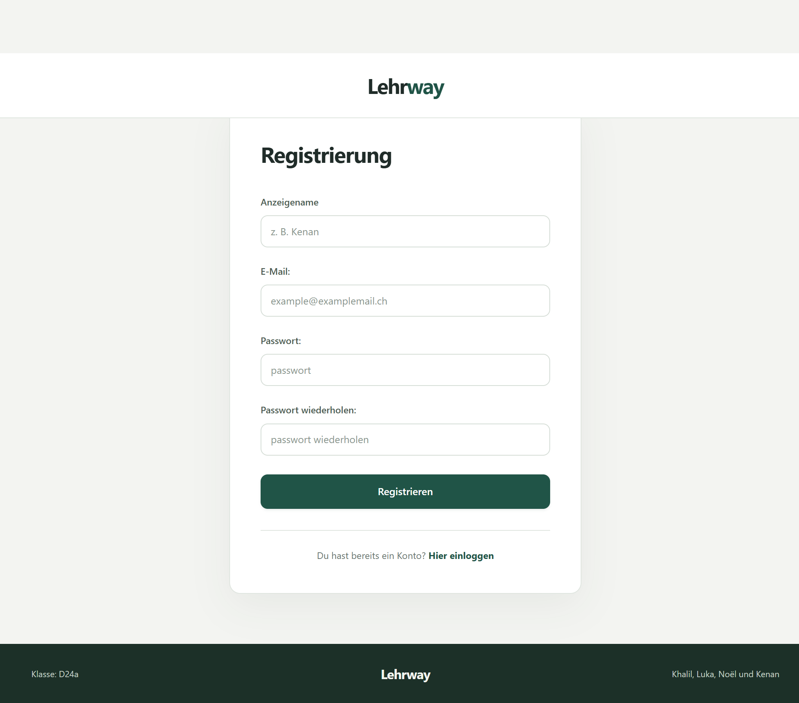

# Frontend-Seiten

| Seite | Route | Aufgabe |
| --- | --- | --- |
| [Wochenplan](#wochenplan) | `/home` | Klassen, Schultage und Räume planen |
| [Lehrgänge](#lehrgänge) | `/lehrgang` | Module und Lektionen über Quartale verteilen |
| [Änderungsverlauf](#änderungsverlauf) | `/logs` | Änderungen im Team nachvollziehen |
| [Login](#login) | `/` | Mit E-Mail und Passwort anmelden |
| [Registrierung](#registrierung) | `/register` | Ein Konto mit Anzeigenamen erstellen |

## Wochenplan

Nach dem Login führt Lehrway zur Wochenübersicht. Links stehen Klassensuche und Klassenauswahl. In der Tabelle lassen sich Schultage bearbeiten und die Raumbelegung pro Tag prüfen. Die Bearbeitung einer Klasse öffnet sich in einer Seitenleiste.

[Quellcode der Wochenplanseite](../src/pages/homepage.vue)

## Lehrgänge

Links stehen Suche und Auswahl der Lehrgänge. Nach der Auswahl können Name und Semesterzahl bearbeitet werden. Der Lehrplan zeigt die Module und ihre Lektionen in der Quartalsansicht.

[Quellcode der Lehrgangsseite](../src/pages/lehrgangpage.vue)

## Änderungsverlauf

Über **Logs** in der Navigation gelangt das Team zum gemeinsamen Änderungsverlauf. Die Filter stehen oberhalb der Einträge. Aufklappbare Details zeigen, welche Werte sich geändert haben, sofern sie für den Eintrag protokolliert wurden.

[Änderungsverlauf als vollständiges Bild öffnen](bilder/lehrway-logpage.png)

[Quellcode der Logseite](../src/pages/logpage.vue)

## Login

Die Anmeldeseite fragt nach E-Mail und Passwort. Rückmeldungen erscheinen im Formular. Nach erfolgreicher Anmeldung öffnet sich der Wochenplan.

[Quellcode der Loginseite](../src/pages/loginpage.vue)

## Registrierung

Das Formular enthält Anzeigename, E-Mail, Passwort und Passwortbestätigung. Nach erfolgreicher Registrierung erscheint auf der Loginseite eine Bestätigung.

[Quellcode der Registrierungsseite](../src/pages/registerpage.vue)